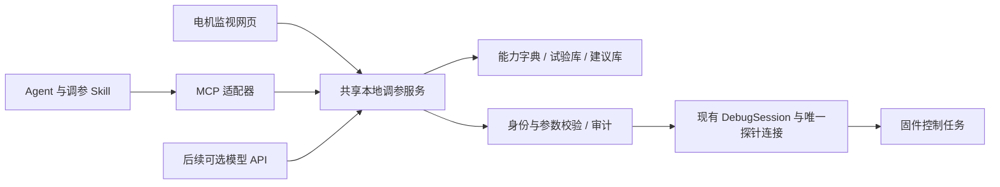

# AI 调参：流程、界面与接口

状态：设计 v0.1，2026-11-15；本轮只落设计，未实现 MCP、Skill、模型 API 或自动试验。配套：[参数能力字典](ai-parameter-capabilities.md)、[试验数据格式](ai-trial-format.md)。

2026-11-16 更新：先交付 [最简版](ai-quickstart.md)，提供参数 / 采样材料生成与文字回复暂存；MCP、Skill、模型 API 和自动试验仍未实现。

## 架构决定

先建立共享本地调参服务与统一数据格式，再给外部 agent 提供 MCP 工具和后续调参 Skill。网页保留观测、手动控制、建议差异和应用记录。以后内嵌模型 API 复用同一份 trial、proposal 与校验器，模型供应商不进入板端控制层。

这里的 MCP 指计划中的工具适配层；它提供上下文与受限操作，不提供推理能力。Skill 说明分析流程与固件知识，不能承担权限执行。首期不依赖某个协议版本或特定 agent 产品，接入实现时再核对目标客户端支持。

模型在试验之间读数据、解释与提出候选，不参与实时 PID 反馈。SWD / RTT 的数据量和延迟由实测决定；主机与模型不承担控制周期时限。

## 当前界面怎么放

沿用「电机监视」重点电机，不新增独立调参主页面。

| 位置 | 内容与操作 |
| --- | --- |
| 列表与重点电机标题 | 保留现有 enable / disable 开关与板端读回状态；监视开关继续独立 |
| 现有角度盘、目标和手动参数区 | 保留交互；每项补单位、是否生效、更新者和不可写原因 |
| 手动参数区内，PID 参数旁 | 增加“模式与滤波”折叠区：电机模式、两环特性位、alpha / A / B；尚不支持的开关显示只读原因 |
| 重点电机曲线下 | “调参试验”：目标 / 负载说明、记录基线、结束记录、采样质量、试验列表与对照 |
| 试验区下 | “AI 分析”：待发送数据清单、分析结果、建议 diff、证据时间窗、缺失数据与下一次试验 |
| diff 内 | 旧值 / 当前板端值 / 建议值 / 范围来源 / 状态处理；人工选择应用或驳回 |

“记录试验”仅界定正在采集的数据窗口，不暗中改变目标、模式或使能。拖动角度盘属于手动探索：保存实际下发、读回和目标被任务覆盖的事件，不将手工轨迹包装为可重复阶跃。

模式与滤波不做一排默认全可用的 toggle：先显示是否存在、是否开启、是否参与当前路径；只有语义命令、状态处理与验证具备后才开放修改。未启用的滤波系数旁显示“当前未生效”，避免只改 alpha 后误以为滤波已经开启。

## 调参阶段

1. 确认固件身份、方向、坐标、减速比、实际控制模式、目标来源和约束，建立当前参数基线。未知项保留在 readiness 清单。
2. 先调速度环，再调角度级联。速度环隔离需要模式 / 目标控制能力；当前没有模式命令时先由固件或操作者建立明确的试验模式，不让 agent 写模式位。
3. 每轮围绕一个可解释假设改变一组相关参数，保留其他条件和初始状态；没有足够数据先补采，不能跳到数值建议。
4. 有噪声或动态滞后证据后单独比较反馈 / D / 输出滤波；保护位不作为常规搜索维度。
5. 单电机稳定后再调多电机一致性、底盘与云台补偿；增加真实车体参考量，区分动力学、坐标错误和补偿模型问题。

用户可设目标优先级，例如静态偏差、跟踪速度、超调、抖动、温升 / 电流。上限来自实际驱动和机构认可配置，不由模型推测；当前缺失时建议先建立范围和试验条件。

## 试验与建议状态

试验：draft → readiness_checked → recording → sealed → analyzed。意外配置变化 / 丢失身份 / 采集质量不满足时记录 invalid 或 split segments，不悄悄补齐。sealed 后原始数据不可变；重新分析产生新结果版本。

建议：draft → validated 或 blocked → operator_selected → applying → verified / partial / failed / unconfirmed。基线、身份、模式、能力或配置变化使建议 stale。verified 只指本次写入读回符合，持续观察确认和后续性能试验另记，不代表长期稳定或性能改善。

enable 改变、拖动目标、手动改参、上层任务覆盖也进入同一审计流；应用建议后另录一次对照试验，不能直接把“写成功”标成“调参成功”。

## 首期 MCP 工具契约

名称为拟定的业务工具名，尚不存在这些端点。所有响应带 schema / adapter 版本、session 与证据时间，返回值明确区分缓存和新鲜读数。工具默认只处理同一已选工作区与会话。

| 工具 | 输入 | 输出与边界 |
| --- | --- | --- |
| list_motors | session_id、cursor、limit | 有界目录、不透明 motor_id、家族 / 在线与采样时间；不触发 CAN 探测 |
| get_motor_context | motor_id、include 参数组 | 最新配置快照、完整性、能力字典、模式 / 更新者、readiness；新读失败不返回假“当前值” |
| list_trials | motor_id、cursor、limit、时间范围 | 不可变摘要与数据质量；默认只列本工作区 |
| get_trial | trial_id、通道白名单、时间窗、cursor、limit | 元数据 / 摘要或原始分块、next_cursor、截断说明；不接受文件路径 |
| compare_trials | trial_ids、计划变动项、指标集合 | 可比性检查、确定性指标及不足原因，不自动挑“最佳” |
| submit_proposal | proposal、submission_key | 只保存网页草稿，返回 proposal_id、校验状态、阻止原因；不写 RAM |

服务端固定集合校验输入，不接收任意 Python / shell / OpenOCD 命令、任意变量路径或文件读取。首期上限建议：列表每页 1–50 项、每块最多 2,000 样本和 1 MiB、单次比较 2–4 次试验、建议最多 16 个参数；这是接口资源边界，不是电机试验限制。超限报错或显式分页，不静默截断，MCP 与网页使用一致的上限策略。

首期不向 agent 暴露写入、使能、目标拖动、模式切换、清故障、试验刺激执行或任意 RAM 权限。submit_proposal 是本地文档写入，与板端控制分开授权。后续新增执行工具必须单独定义固件支持和权限，不能因接入 MCP 自动继承网页 token 的全部能力。

## 单探针、服务认证与 Skill

现有 DebugSession 保留唯一探针所有权。MCP 适配器调用共享服务，不能另建一个 OpenOCD 连接与网页竞争。对采样 / 写入 / ELF 切换继续使用同一会话锁；长时间模型调用在锁外运行，结果提交时重验身份。

首期可用本地 stdio 适配器，由用户配置客户端启动；它通过受限的本地 broker 凭据调用业务接口。现有 HTTP Host / Origin / CSRF token 校验保持，不能为了非浏览器客户端全局关闭；broker 使用独立认证和仅限上述工具的权限，不借用浏览器全权 token。连接新会话要显式绑定，断线 / ELF 切换使旧绑定失效；不开放公网控制入口。具体传输和客户端配置在接入阶段核对。

后续 Skill 包计划包括 SKILL.md、字段 / 模式说明、分析流程、报告模板和离线指标工具。流程固定为“读上下文 → 检查数据资格 → 解释假设 → 提交候选或补采计划 → 等待人工试验结果”。Skill 不保存密钥、不扩大工具权限，也不通过 shell 绕过被阻止的操作。本轮未创建或安装 Skill。

如果以后接入网页内模型 API，后端持有密钥，前端只选择模型与数据预览；结构化输出仍走 submit_proposal 同一校验器。API 回包是候选数据，不是可执行命令。首次产品选型和实现时再确认模型接口、费用和数据政策，不把它们写成当前已有能力。

## 人工应用与并发校验

以下是计划补充的服务端能力，当前 write_motor 仅做已有对象 / 模式 / 类型 / 范围校验和顺序写入，没有配置版本比较或整组原子事务。

1. 接收建议时验证类型、有限数值、参数 ID 白名单、角色权限、证据和工程范围；生成可评审 diff。synthetic 包永不绑定实时应用。
2. 操作者应用前校验 session、ELF 哈希、object_incarnation、模式、能力 / 配置版本和过期时间；新读板端参数，与 expected_before 的实际 float32 编码值比较。不能用宽松 epsilon 掩盖外部修改。
3. 对建议依赖的完整配置做新鲜度和一致性核对，不只看改动字段。与服务端 revision 一起使用，发现上层任务覆盖或模式变化即 stale。SWD 读写之间仍可能有固件竞争，无法给出严格 compare-and-swap 保证；更新者未知 / 持续覆盖的参数不允许自动套用。
4. 人工选择的相关参数作为明确一组，服务端预检全部字段。现阶段顺序执行、逐项读回，每次写前再检查身份 / 模式；遇到不匹配或失败停止，报告已写 / 未写 / 无法确认，禁止声称整组原子成功。需要无中间态的改动等待固件边界提交命令。
5. 使用 submission_key 防重复草稿；另用 application_key 保存应用请求状态。超时后先查询原请求 / 读回核实，不盲目重发。持久审计与请求状态一起保存，服务重启后无法证明完成的请求标 unconfirmed。
6. 保留写前、请求、实际 float32 读回、持续观察和后续试验结果。回退也基于新读和同等校验，不能自动恢复旧 enable / 目标 / 失效配置；部分失败不自动整组回滚。

本地 disable 维持专用操作路径，沿用现有写入队列协调，不被等待模型阻塞；它仍是固件下一次执行时归零的软件失能。不能承诺主机 SWD 在任何故障下及时停机，也不能用建议应用结果代替板端状态。

## 以后如何做重复试验

先将手动记录做可靠，再设计固件命令：明确刺激形状、工程认可幅度 / 速度 / 持续时间、目标来源、唯一控制者租约、执行确认与结束状态。固件按本地时钟执行并记录实际刺激、循环序号和遥测；板端负责 deadline / 约束 / 失联后的终止行为。租约只约束主机而不约束上层任务是不够的。

开始试验需操作者选择已审核计划，agent 仅提出下一轮方案。目标来源切换、模式切换、PID 历史处理和试验后状态必须由固件定义；命令邮箱 / RTT 下行等传输方式待评估，不能等同于任意内存写入。没有这些支持时，“记录一次手动操作”不会升级为“AI 自动跑试验”。

## 落地顺序与验收

| 阶段 | 交付 | 验收条件 |
| --- | --- | --- |
| 1：能力与数据 | 模式 / 滤波只读展示、能力字典、开始 / 结束快照、试验记录与导出 | 缺失不补零；inactive 有原因；旧导出可识别；合成数据不可应用；不改现有 enable / 拖动语义 |
| 2：建议闭环 | 本地试验库、确定性质量 / 指标、建议 diff、版本和读前比较、审计 | 低率数据不产出假精确指标；过期建议被拒；部分完成准确呈现；超时重试不重复写入 |
| 3：Agent 接入 | 受限 MCP 适配器、调参 Skill、外发预览 | 单探针；只读与草稿权限可验证；任意地址 / 越界数据访问被拒；无需模型也可完成手动试验与对照 |
| 4：固件试验支持 | 遥测、语义配置命令、重复刺激、板端终止机制 | 对应固件审阅与台架验证，确认执行序号、更新者排他、命令幂等和失败状态 |
| 5：拓展 | 整车补偿、可选内嵌模型 API | 共用能力 / 试验 / 建议契约；实际车体参考量和补偿模型参数可追溯 |

下一步实现应从阶段 1 开始：让当前电机监视先准确回答“现在是什么参数、哪些真的生效、这段数据能说明什么”，随后接 agent 才有可靠依据。
